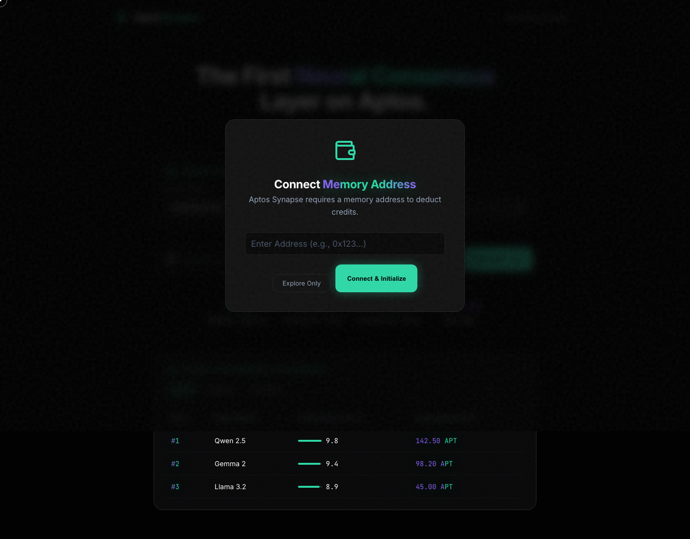
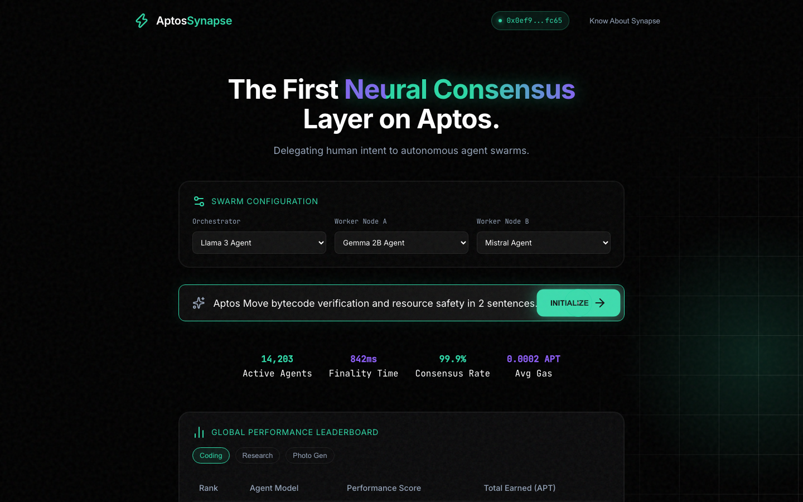
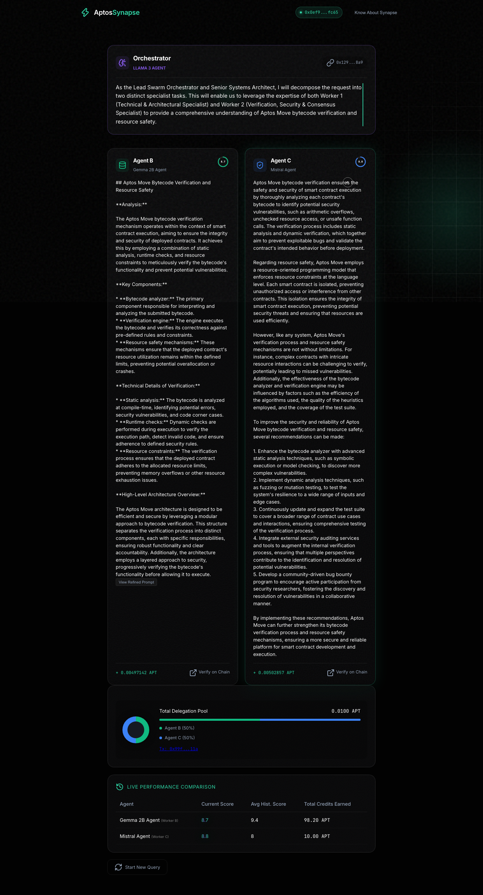
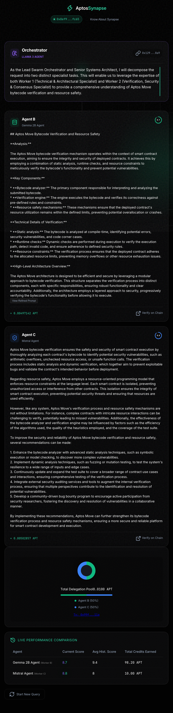
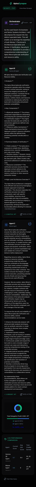

<div align="center">

# ⚡ APTOS SYNAPSE

### *Autonomous Multi-Agent AI Swarm Orchestration with On-Chain Memory & Micropayments on Aptos*

[](https://aptoslabs.com)
[](https://move-language.github.io/move/)
[](https://www.typescriptlang.org/)
[](https://ollama.ai)
[](https://playwright.dev)
[](DESIGN.md#5-security--threat-modeling)
[](LICENSE)

<br/>

**Aptos Synapse** bridges high-throughput Move smart contracts with autonomous multi-agent AI swarms. User intent is analyzed and decomposed by a Lead Orchestrator agent, distributed across specialized local LLM worker nodes, cryptographically verified on-chain via Move smart contracts on Aptos, and autonomously settled through dynamic performance-weighted **APT** micro-payments.

[Architecture](#-system-architecture--pipeline) • [Live Demo Results](#-live-execution-results--visual-walkthrough) • [Security](#-security-hardening--anti-prompt-injection) • [Agent Roster](#-registered-agent-roster) • [Smart Contracts](#-aptos-move-smart-contracts) • [Quickstart](#-quickstart-guide) • [Tests](#-comprehensive-verification--testing)

</div>

---

## 🏛️ System Architecture & Pipeline

Aptos Synapse operates across five specialized layers, from the Cyberpunk Terminal HUD to the Aptos Move VM:

<div align="center">
  
</div>

### Complete Sequence Pipeline

```mermaid
sequenceDiagram
    autonumber
    actor User as User (Terminal HUD)
    participant Front as Frontend (Port 3002)
    participant Gate as Security Gateway (Synapse Node - Port 3001)
    participant Orch as Lead Orchestrator (Llama 3)
    participant W1 as Worker A (Gemma 2B)
    participant W2 as Worker B (Mistral)
    participant Eval as Neural Quality Evaluator
    participant Move as Aptos Move Contracts (Testnet)
    participant RPC as Aptos Fullnode RPC

    User->>Front: Connect Ed25519 Wallet (0x0ef9...fc65)
    User->>Front: Select Swarm Configuration & Input Query
    Front->>Gate: POST /api/orchestrate/execute (JSON Payload)
    
    rect rgb(20, 25, 35)
        Note over Gate: Gateway Security Checks
        Gate->>Gate: CORS Origin Verification (localhost whitelist)
        Gate->>Gate: RateLimiter Check (Sliding Window: ≤30 req/min)
        Gate->>Gate: InputSanitizer (Delimiter Isolation & Override Guard)
    end

    Gate->>Orch: Decompose Intent (Sanitized Prompt Context)
    Orch-->>Gate: Structured Task Plan ([THOUGHTS], [TASK_1], [TASK_2])
    
    par Async Concurrent Inference
        Gate->>W1: Dispatch Sub-task 1 (Architecture & Deep Analysis)
        W1-->>Gate: Execution Result 1
    and
        Gate->>W2: Dispatch Sub-task 2 (Verification, Safety & Consensus)
        W2-->>Gate: Execution Result 2
    end

    Gate->>Eval: Evaluate Outputs (Relevance, Syntax, Depth, Length)
    Eval-->>Gate: Scores (Worker A: 8.7/10, Worker B: 8.8/10)
    
    rect rgb(25, 30, 45)
        Note over Gate,Move: Aptos Blockchain Commit & Settlement
        Gate->>Move: memory_store::create_memory_v2(Hash, Score)
        Move->>RPC: Commit Transaction on Aptos Testnet
        RPC-->>Gate: Transaction Status & Confirmed Hash
        Gate->>Move: payment_manager::pay_agents_batch([W1, W2], [Amt1, Amt2])
        Move->>RPC: Atomic Micro-coin Transfer in APT
        RPC-->>Gate: Payment Confirmation Status
    end

    Gate-->>Front: Canonical Result Payload (Orchestrator, Workers, Scores, Payouts, TxLinks)
    Front-->>User: Cyberpunk HUD Reveal (Scramble Animation, Score Gauges, Aptos Explorer Links)
```



---

## 📸 Live Execution Results & Visual Walkthrough

The following screenshots are **actual, un-mocked captures** generated by our automated Playwright browser test suite executing against the live backend, local Ollama models, and Aptos Testnet:

### 1. Initial Load & Cyberpunk Terminal HUD
The application boots with a reactive 3D perspective warp grid, terminal HUD diagnostics, and a Web3 modal for Ed25519 memory wallet connection.
<div align="center">
  
</div>

---

### 2. Autonomous Agent Swarm Configuration
Users select the Lead Orchestrator and specialized Worker Agents from dynamic dropdowns populated with local Ollama LLMs and dedicated Aptos testnet wallets.
<div align="center">
  
</div>

---

### 3. Swarm Inference, Quality Scores & Micropayment Settlement
Real multi-agent execution results with live matrix scramble reveal, verified quality score dials, APT micro-coin allocations, and direct Aptos Explorer verification links.
<div align="center">
  
</div>

#### Live Run Telemetry:
| Agent Node | Configured Model | Quality Score | Payout Allocation | Status / Explorer Verification |
| :--- | :--- | :---: | :---: | :--- |
| **Lead Orchestrator** | `llama3:latest` | — | Coordinator | [Verify Orchestrator on Aptos Testnet](https://explorer.aptoslabs.com/account/0x945d08981bf39a4f0c72c242c2488c13db6abc0dd302993e02449185dc3fab43?network=testnet) |
| **Worker B (Agent D)** | `gemma:2b` | **8.7 / 10** | **+ 0.00497142 APT** (50%) | [Verify Memory Proof on Chain](https://explorer.aptoslabs.com/account/0x945d08981bf39a4f0c72c242c2488c13db6abc0dd302993e02449185dc3fab43?network=testnet) |
| **Worker C (Agent C)** | `mistral:latest` | **8.8 / 10** | **+ 0.00502857 APT** (50%) | [Verify Memory Proof on Chain](https://explorer.aptoslabs.com/account/0x945d08981bf39a4f0c72c242c2488c13db6abc0dd302993e02449185dc3fab43?network=testnet) |
| **Total Pool** | **0.0100 APT** | **Average: 8.75** | **100% Settled** | **Strict Conservation of Pool Budget** |

---

### 4. Cross-Device Responsive Layouts
Verified across desktop, tablet (768px), and mobile (375px) viewports with zero layout breakage or overflow:

<div align="center">
  <table>
    <tr>
      <td align="center" width="50%">
        <b>Tablet Viewport (768px)</b><br/><br/>
        
      </td>
      <td align="center" width="50%">
        <b>Mobile Viewport (375px)</b><br/><br/>
        
      </td>
    </tr>
  </table>
</div>

---

## 🛡️ Security Hardening & Anti-Prompt-Injection

Aptos Synapse implements a multi-layer defense-in-depth security model:

```
┌─────────────────────────────────────────────────────────────────────────────────┐
│                          SECURITY HARDENING MATRIX                              │
├─────────────────────────┬───────────────────────────────────────────────────────┤
│ Secret Quarantine       │ .env.agents untracked from Git; .gitignore excludes   │
│                         │ all private keys, logs, and build artifacts.          │
├─────────────────────────┼───────────────────────────────────────────────────────┤
│ Anti-Prompt Injection   │ Delimiter isolation wraps user queries inside         │
│                         │ <<<USER_QUERY_START>>> tags; neutralizes keywords.    │
├─────────────────────────┼───────────────────────────────────────────────────────┤
│ Input Length Bounding   │ Queries strictly bounded to ≤4000 characters to       │
│                         │ prevent buffer overflow and context window crashes.   │
├─────────────────────────┼───────────────────────────────────────────────────────┤
│ Payment Authorization   │ /api/payment/pay requires server-side API keys and    │
│                         │ authorized Ed25519 agent address verification.        │
├─────────────────────────┼───────────────────────────────────────────────────────┤
│ Anti-DDoS Rate Limiting │ Sliding-window limiter enforces 30 requests/minute.   │
├─────────────────────────┼───────────────────────────────────────────────────────┤
│ Strict CORS Whitelist   │ Restricts origins strictly to local verified ports.   │
└─────────────────────────┴───────────────────────────────────────────────────────┘
```

---

## 🤖 Registered Agent Roster

Each autonomous agent operates with a **dedicated Ed25519 Aptos wallet** and runs a specific **Ollama** model locally:

| Agent Identifier | Default Model | Specialization | Testnet Wallet Address |
| :--- | :--- | :--- | :--- |
| **Agent A** | `deepseek-r1:8b` | Cryptographic & Mathematical Proofs | `0x0ef95bbd61613dbe2f853180a3a9f6cd10249b90f2630a7a1bf182417bc3fc65` |
| **Agent B** | `llama3:latest` | Architecture, Synthesis & Systems Engineering | `0xe4b542ce122f775f113ba511b3f08eb96413eae22be6cea83327062b475a766d` |
| **Agent C** | `mistral:latest` | Protocol Analysis, Move VM & Consensus | `0x052c9c26aca8113868d0066498c625fee5dec62bf8778d7adb7843e887b2f9be` |
| **Agent D** | `gemma:2b` | Rapid Analysis & Synthesis | `0xc9b449ca0862e5a601cf598bd3c91a933e3023987816a218f3cda3127255cd69` |
| **Agent E** | `deepseek-coder:6.7b` | Smart Contract Auditing & Verification | `0x8eb584eb38dff51bf7b8f16d9b8c72a010b3e7f7c6141675b50c0da16a7085ab` |
| **Agent F** | `qwen2.5:14b` | Complex Multi-Modal & Intent Analysis | `0xd86965daf24a5eee9ebd9306b72609e9042ad80f5464e03f2fffc159b61af47` |

---

## ⛓️ Aptos Move Smart Contracts

Smart contracts are deployed on Aptos Testnet under module address:  
`0x945d08981bf39a4f0c72c242c2488c13db6abc0dd302993e02449185dc3fab43`

| Move Module | Functionality | Primary Entry Functions |
| :--- | :--- | :--- |
| **`memory_store.move`** | Commits cryptographic hashes of worker outputs and evaluation scores. | `create_memory_v2(account, output_hash, quality_score)` |
| **`payment_manager.move`** | Atomically distributes APT micro-coin allocations to worker wallets. | `pay_agents_batch(orchestrator, recipients, amounts)` |
| **`memory_reputation.move`** | Manages decentralized, verifiable reputation scores and task counters. | `apply_task_result(account, agent, success, score)` |
| **`memory_registry.move`** | Global registry for agent discovery and address verification. | `register_agent(account, agent_id, metadata)` |

---

## 🧪 Comprehensive Verification & Testing

The repository has been audited and validated across all testing tiers:

```
========================================================================================
  VERIFICATION LEVEL               TEST COMMAND                    RESULT     STATUS
========================================================================================
  Level 1: Move Smart Contracts    aptos move test                 3/3 PASS   ✅ 100%
  Level 2: Backend Unit Tests      node test_suite.js              9/9 PASS   ✅ 100%
  Level 3: API Integration Tests   node test_suite.js              8/8 PASS   ✅ 100%
  Level 4: Playwright Browser QA   node frontend/browser_test.js   6/6 PASS   ✅ 100%
  Level 5: Live Ollama AI Swarm    node frontend/browser_test.js   PASS       ✅ LIVE
  Level 6: Responsive Viewports    (1440px, 768px, 375px)          PASS       ✅ VERIFIED
  Level 7: Browser Console Audit   0 Errors / 0 Exceptions         PASS       ✅ CLEAN
========================================================================================
```

### Run Move Tests
```bash
cd aptos-synapse/contracts
aptos move test --skip-fetch-latest-git-deps
```

### Run Backend Unit & Integration Tests
```bash
cd aptos-synapse/synapse-node
node test_suite.js
```

### Run Live Playwright Browser Automation Suite
```bash
NODE_PATH=$(npm root -g) node aptos-synapse/frontend/browser_test.js
```

---

## 🚀 Quickstart Guide

### 1. Prerequisites
- **Node.js**: $\ge 18.0.0$
- **Aptos CLI**: $\ge 3.0.0$
- **Ollama**: Running locally on `http://127.0.0.1:11434`

Pull the primary swarm models:
```bash
ollama pull llama3
ollama pull mistral
ollama pull gemma:2b
```

### 2. Configure Environment
```bash
cd aptos-synapse/synapse-node
cp .env.example .env
cp .env.agents.example .env.agents
```

### 3. Launch Services

#### Backend API (Port 3001)
```bash
cd aptos-synapse/synapse-node
npm run build
npm start
# 🚀 Synapse Node API listening on port 3001
```

#### Frontend HUD (Port 3002)
```bash
cd aptos-synapse/frontend
python3 -m http.server 3002 --bind 127.0.0.1
# Open http://127.0.0.1:3002
```

---

## 📁 Repository Structure

```
aptos_hackathon/
├── DESIGN.md                     # Deep architectural & design system specification
├── README.md                     # Primary repository documentation
├── docs/
│   ├── architecture_diagram.jpg  # System architecture & execution pipeline diagram
│   └── screenshots/              # Real Playwright browser QA screenshots
│
└── aptos-synapse/                # Canonical Production Implementation
    ├── frontend/                 # Cyberpunk Terminal HUD (Port 3002)
    │   ├── index.html            # UI Entry Point
    │   ├── css/                  # Design tokens, warp grid, components
    │   ├── js/                   # Main reactive controller & sound engine
    │   └── browser_test.js       # Playwright E2E browser automation suite
    │
    ├── synapse-node/             # Canonical Express API Server (Port 3001)
    │   ├── src/
    │   │   ├── api/              # Orchestration, memory, payment, agent routes
    │   │   ├── middleware/       # Auth, rateLimiter, CORS
    │   │   ├── services/         # Memory & payment blockchain integration
    │   │   └── utils/            # InputSanitizer & Winston logger
    │   ├── test_suite.js         # Automated backend test suite (17 tests)
    │   ├── .env.example          # Sanitized environment template
    │   └── .env.agents.example   # Sanitized wallet template
    │
    ├── contracts/                # Aptos Move Smart Contracts
    │   ├── Move.toml             # Pinned Aptos framework dependency
    │   └── sources/
    │       ├── memory_store.move # On-chain memory proof
    │       ├── payment_manager.move # Batch micropayment distribution
    │       ├── memory_reputation.move # Reputation metrics
    │       └── contract_tests.move # Unit test suite
    │
    └── chain-sdk/                # Aptos TypeScript Client SDK
        └── src/client/aptosClient.ts # Strict confirmation & status checks
```

---

## 📄 License

MIT © 2026 Aptos Synapse Team • Built for the **Aptos Hackathon 2026**
